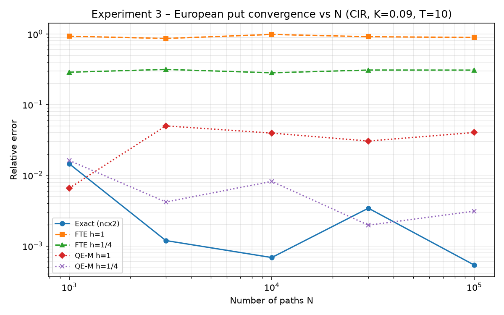
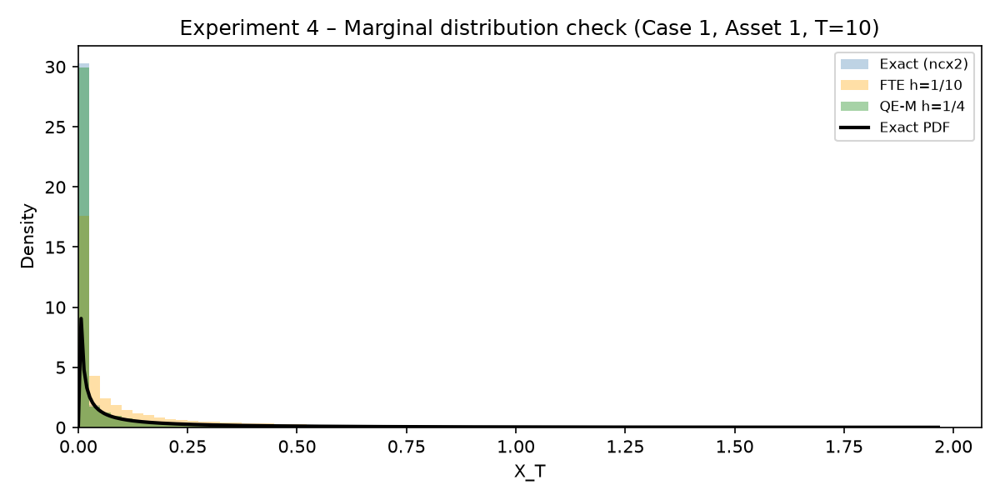
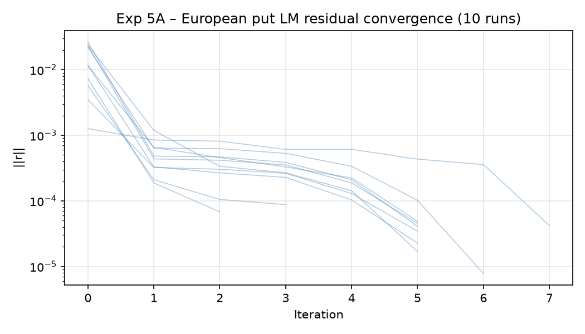
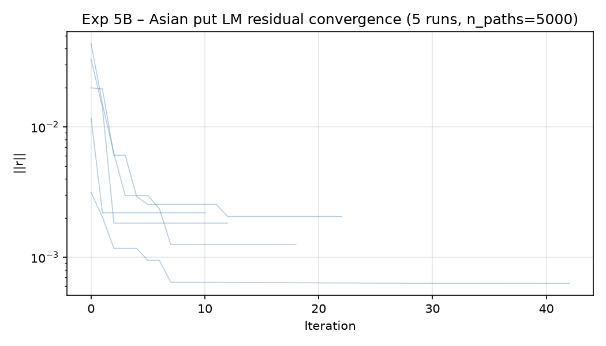

## Experiment 3 – CIR Pricing

Parameters: X0=0.09, a=0.045, b=-0.5, c=1.0, delta=0.18, T=10.0, K=0.09, N=100000

Analytical (benchmark) European put = 0.06931460

### European put (N=100 000)

| Method       | h   | n_steps   |    Price |   StdErr |   RelErr |   CPU (s) |
|:-------------|:----|:----------|---------:|---------:|---------:|----------:|
| Exact (ncx2) | —   | —         | 0.069352 | 0.000108 | 0.000536 |  0.005447 |
| FTE          | 1   | 10        | 0.131217 | 0.000655 | 0.893058 |  0.021026 |
| FTE          | 1/2 | 20        | 0.106374 | 0.000374 | 0.534649 |  0.039764 |
| FTE          | 1/4 | 40        | 0.090667 | 0.000238 | 0.308044 |  0.079707 |
| QE-M         | 1   | 10        | 0.072112 | 0.000110 | 0.040354 |  0.055865 |
| QE-M         | 1/2 | 20        | 0.070223 | 0.000112 | 0.013101 |  0.116911 |
| QE-M         | 1/4 | 40        | 0.069099 | 0.000112 | 0.003106 |  0.250677 |

### Asian put M=10 (yearly)

| Method   | h   | n_steps_per_int   |    Price |   StdErr |   CPU (s) |
|:---------|:----|:------------------|---------:|---------:|----------:|
| Exact    | —   | —                 | 0.046340 | 0.000108 |  0.053591 |
| FTE      | 1   | 1                 | 0.074137 | 0.000232 |  0.020264 |
| QE-M     | 1   | 1                 | 0.047057 | 0.000113 |  0.028198 |
| FTE      | 1/2 | 2                 | 0.064596 | 0.000187 |  0.034815 |
| QE-M     | 1/2 | 2                 | 0.046350 | 0.000110 |  0.054660 |
| FTE      | 1/4 | 4                 | 0.057331 | 0.000153 |  0.059560 |
| QE-M     | 1/4 | 4                 | 0.046378 | 0.000108 |  0.117340 |

### Asian put M=40 (quarterly)

| Method   | h    | n_steps_per_int   |    Price |   StdErr |   CPU (s) |
|:---------|:-----|:------------------|---------:|---------:|----------:|
| Exact    | —    | —                 | 0.044494 | 0.000103 |  0.245799 |
| FTE      | 1/4  | 1                 | 0.054872 | 0.000143 |  0.078297 |
| QE-M     | 1/4  | 1                 | 0.044509 | 0.000103 |  0.136677 |
| FTE      | 1/8  | 2                 | 0.050451 | 0.000125 |  0.122678 |
| QE-M     | 1/8  | 2                 | 0.044431 | 0.000103 |  0.279689 |
| FTE      | 1/16 | 4                 | 0.047753 | 0.000114 |  0.222582 |
| QE-M     | 1/16 | 4                 | 0.044575 | 0.000102 |  0.585920 |

Convergence plot: 

## Experiment 4 – Basket CIR Put Pricing

d=5, T=10.0, K=0.09, w_i=1/5, X0=0.09, N=100000

*Note: representative parameter cases (Table 5 not reproduced verbatim).*

### Basket prices

| Case              | Method     | n_steps   |    Price |   StdErr |   CPU (s) |
|:------------------|:-----------|:----------|---------:|---------:|----------:|
| Case 1 (baseline) | Exact      | —         | 0.045217 | 0.000116 |  0.021375 |
| Case 1 (baseline) | FTE h=1/10 | 100       | 0.049921 | 0.000138 |  0.841338 |
| Case 1 (baseline) | QE-M h=1/4 | 40        | 0.045056 | 0.000116 |  1.289218 |
| Case 2 (slow rev) | Exact      | —         | 0.037257 | 0.000118 |  0.020834 |
| Case 2 (slow rev) | FTE h=1/10 | 100       | 0.043121 | 0.000141 |  0.840542 |
| Case 2 (slow rev) | QE-M h=1/4 | 40        | 0.037265 | 0.000118 |  1.345150 |
| Case 3 (high vol) | Exact      | —         | 0.051208 | 0.000119 |  0.020049 |
| Case 3 (high vol) | FTE h=1/10 | 100       | 0.059187 | 0.000153 |  0.841432 |
| Case 3 (high vol) | QE-M h=1/4 | 40        | 0.050883 | 0.000119 |  1.231378 |
| Case 4 (mixed)    | Exact      | —         | 0.045122 | 0.000119 |  0.020530 |
| Case 4 (mixed)    | FTE h=1/10 | 100       | 0.051704 | 0.000147 |  0.843039 |
| Case 4 (mixed)    | QE-M h=1/4 | 40        | 0.044810 | 0.000119 |  1.274689 |

### KS tests – Case 1 marginals

|   Asset |   KS_FTE |   p_FTE |   KS_QEM |   p_QEM |
|--------:|---------:|--------:|---------:|--------:|
|  1.0000 |   0.5008 |  0.0000 |   0.6836 |  0.0000 |
|  2.0000 |   0.4991 |  0.0000 |   0.6811 |  0.0000 |
|  3.0000 |   0.4988 |  0.0000 |   0.6798 |  0.0000 |
|  4.0000 |   0.4998 |  0.0000 |   0.6825 |  0.0000 |
|  5.0000 |   0.4994 |  0.0000 |   0.6804 |  0.0000 |

Marginal plot: 

## Experiment 5 – LM Calibration

True theta: delta=0.18, b=-0.5, c=1.0  (a=0.0450)
X0=0.09, Strikes=[0.065, 0.085, 0.09, 0.1, 0.11, 0.12], Maturities=[6.0, 7.0, 8.0, 9.0, 10.0]
European: n_trials=100, n_paths_cal=50000
Asian:    n_trials=20, n_paths_cal=5000 (reduced for tractability; full 100-trial run ~50 min)
perturb_frac=0.20

### Summary

| Study                              |   Mean|delta_err| |   Mean|b_err| |   Mean|c_err| |   Std|delta_err| |   Std|b_err| |   Std|c_err| |   Mean||r|| |   Mean n_iter |   Conv rate (%) |
|:-----------------------------------|------------------:|--------------:|--------------:|-----------------:|-------------:|-------------:|------------:|--------------:|----------------:|
| European (100 trials)              |            0.0009 |        0.0551 |        0.0582 |           0.0010 |       0.0322 |       0.0355 |      0.0001 |        4.6300 |        100.0000 |
| Asian M=10 (20 trials, 5000 paths) |            0.0179 |        0.0509 |        0.0852 |           0.0131 |       0.0375 |       0.0606 |      0.0030 |       18.4000 |        100.0000 |

### European calibration per-trial stats (first 5 rows)

|   Trial |   delta_err |   b_err |   c_err |   ||r|| |   n_iter | converged   |
|--------:|------------:|--------:|--------:|--------:|---------:|:------------|
|       1 |     0.00021 | 0.06960 | 0.06853 | 0.00006 |        5 | True        |
|       2 |     0.00191 | 0.09297 | 0.10676 | 0.00006 |        2 | True        |
|       3 |     0.00136 | 0.05040 | 0.04122 | 0.00005 |        4 | True        |
|       4 |     0.00011 | 0.08045 | 0.07821 | 0.00002 |        5 | True        |
|       5 |     0.00215 | 0.02314 | 0.00628 | 0.00008 |        4 | True        |

### Asian calibration per-trial stats (first 5 rows)

|   Trial |   delta_err |   b_err |   c_err |   ||r|| |   n_iter | converged   |
|--------:|------------:|--------:|--------:|--------:|---------:|:------------|
|       1 |     0.01113 | 0.14790 | 0.12652 | 0.00098 |       21 | True        |
|       2 |     0.00633 | 0.01233 | 0.04676 | 0.00083 |       25 | True        |
|       3 |     0.00504 | 0.00280 | 0.03511 | 0.00092 |       13 | True        |
|       4 |     0.02723 | 0.01219 | 0.13112 | 0.00151 |       13 | True        |
|       5 |     0.00566 | 0.10172 | 0.02370 | 0.00194 |       17 | True        |

Convergence plots:

## Experiment 3 – CIR Pricing

Parameters: X0=0.09, a=0.045, b=-0.5, c=1.0, delta=0.18, T=10.0, K=0.09, N=100000

Analytical (benchmark) European put = 0.06931460

### European put (N=100 000)

| Method       | h   | n_steps   |    Price |   StdErr |   RelErr |   CPU (s) |
|:-------------|:----|:----------|---------:|---------:|---------:|----------:|
| Exact (ncx2) | —   | —         | 0.069352 | 0.000108 | 0.000536 |  0.005683 |
| FTE          | 1   | 10        | 0.131217 | 0.000655 | 0.893058 |  0.020769 |
| FTE          | 1/2 | 20        | 0.106374 | 0.000374 | 0.534649 |  0.039219 |
| FTE          | 1/4 | 40        | 0.090667 | 0.000238 | 0.308044 |  0.083951 |
| QE-M         | 1   | 10        | 0.072112 | 0.000110 | 0.040354 |  0.057102 |
| QE-M         | 1/2 | 20        | 0.070223 | 0.000112 | 0.013101 |  0.119166 |
| QE-M         | 1/4 | 40        | 0.069099 | 0.000112 | 0.003106 |  0.255726 |

### Asian put M=10 (yearly)

| Method   | h   | n_steps_per_int   |    Price |   StdErr |   CPU (s) |
|:---------|:----|:------------------|---------:|---------:|----------:|
| Exact    | —   | —                 | 0.046340 | 0.000108 |  0.053460 |
| FTE      | 1   | 1                 | 0.074137 | 0.000232 |  0.020493 |
| QE-M     | 1   | 1                 | 0.047057 | 0.000113 |  0.028111 |
| FTE      | 1/2 | 2                 | 0.064596 | 0.000187 |  0.034445 |
| QE-M     | 1/2 | 2                 | 0.046350 | 0.000110 |  0.054918 |
| FTE      | 1/4 | 4                 | 0.057331 | 0.000153 |  0.060585 |
| QE-M     | 1/4 | 4                 | 0.046378 | 0.000108 |  0.119671 |

### Asian put M=40 (quarterly)

| Method   | h    | n_steps_per_int   |    Price |   StdErr |   CPU (s) |
|:---------|:-----|:------------------|---------:|---------:|----------:|
| Exact    | —    | —                 | 0.044494 | 0.000103 |  0.229720 |
| FTE      | 1/4  | 1                 | 0.054872 | 0.000143 |  0.077539 |
| QE-M     | 1/4  | 1                 | 0.044509 | 0.000103 |  0.127762 |
| FTE      | 1/8  | 2                 | 0.050451 | 0.000125 |  0.114359 |
| QE-M     | 1/8  | 2                 | 0.044431 | 0.000103 |  0.269397 |
| FTE      | 1/16 | 4                 | 0.047753 | 0.000114 |  0.220712 |
| QE-M     | 1/16 | 4                 | 0.044575 | 0.000102 |  0.577063 |

Convergence plot: 

## Experiment 1: Chebyshev Inverse Chi-Square Sampler

- Coefficient generation time (offline): 0.02s
- Clenshaw vs direct summation max discrepancy: 1.42e-14

### Approximation Accuracy by Delta Interval and Region

| Interval | Region | Max Abs Err | Max Rel Err | Mean Abs Err |
|---|---|---|---|---|
| 0.1_0.2 | 1 | 2.73e-06 | 1.40e+08 | 4.63e-07 |
| 0.1_0.2 | 2 | 2.88e-02 | 1.84e-01 | 6.16e-03 |
| 0.1_0.2 | 3 | 2.66e-01 | 6.33e-02 | 1.42e-02 |
| 0.01_0.02 | 1 | 1.37e-11 | 4.11e+03 | 8.25e-13 |
| 0.01_0.02 | 2 | 3.38e-02 | 2.29e+12 | 1.81e-03 |
| 0.01_0.02 | 3 | 2.54e-01 | 6.74e-02 | 1.04e-02 |
| 0.001_0.002 | 1 | 5.21e-99 | 5.21e-84 | 2.94e-101 |
| 0.001_0.002 | 2 | 5.67e-02 | 1.59e+12 | 7.29e-04 |
| 0.001_0.002 | 3 | 8.74e-02 | 4.18e-02 | 1.15e-02 |

### Derivative Validation

| Interval | Max Rel Err (deriv) | Mean Rel Err (deriv) |
|---|---|---|
| 0.1_0.2 | 5.10e-02 | 2.39e-02 |
| 0.01_0.02 | 1.38e+05 | 3.44e+04 |
| 0.001_0.002 | 1.26e+00 | 4.46e-01 |

## Experiment 2: chi-square Sampler Accuracy & Efficiency

### Central chi-square CPU Benchmark (n=1,000,000)

| delta | Method | Time (s) | Sample Mean | Theoretical Mean |
|---|---|---|---|---|
| 0.1 | direct | 0.1691 | 0.099870 | 0.100000 |
| 0.1 | ahrens_dieter | 0.1245 | 0.099943 | 0.100000 |
| 0.1 | scipy | 0.8002 | 0.099865 | 0.100000 |
| 0.01 | direct | 0.1860 | 0.009929 | 0.010000 |
| 0.01 | ahrens_dieter | 0.1356 | 0.010339 | 0.010000 |
| 0.01 | scipy | 0.6282 | 0.009935 | 0.010000 |
| 0.001 | direct | 0.2005 | 0.000962 | 0.001000 |
| 0.001 | ahrens_dieter | 0.4678 | 0.003219 | 0.001000 |
| 0.001 | scipy | 0.4134 | 0.000959 | 0.001000 |

### Non-central Moment Validation (n=2,000,000)

| delta | lambda | Max Rel Err (k=1..10) |
|---|---|---|
| 0.001 | 0.1595 | 3.69e-01 |
| 0.001 | 15.9995 | 1.28e-02 |
| 0.01 | 0.15505 | 4.62e-01 |
| 0.01 | 15.995 | 7.69e-03 |
| 0.1 | 0.11517 | 2.25e-01 |
| 0.1 | 15.9501 | 4.47e-02 |

## Experiment 1: Chebyshev Inverse Chi-Square Sampler

- Coefficient generation time (offline): 0.02s
- Clenshaw vs direct summation max discrepancy: 1.42e-14

### Approximation Accuracy by Delta Interval and Region

| Interval | Region | Max Abs Err | Max Rel Err | Mean Abs Err |
|---|---|---|---|---|
| 0.1_0.2 | 1 | 2.73e-06 | 1.40e+08 | 4.63e-07 |
| 0.1_0.2 | 2 | 6.19e-01 | 1.08e+01 | 1.27e-01 |
| 0.1_0.2 | 3 | 6.25e-01 | 1.17e+00 | 1.08e-01 |
| 0.01_0.02 | 1 | 1.37e-11 | 4.11e+03 | 8.25e-13 |
| 0.01_0.02 | 2 | 5.65e-01 | 3.15e+08 | 4.44e-02 |
| 0.01_0.02 | 3 | 5.86e-01 | 1.08e+00 | 9.95e-02 |
| 0.001_0.002 | 1 | 5.21e-99 | 5.21e-84 | 2.94e-101 |
| 0.001_0.002 | 2 | 6.11e-01 | 2.99e+10 | 4.86e-03 |
| 0.001_0.002 | 3 | 6.35e-01 | 9.13e-01 | 1.06e-01 |

### Derivative Validation

| Interval | Max Rel Err (deriv) | Mean Rel Err (deriv) |
|---|---|---|
| 0.1_0.2 | 5.10e-02 | 1.72e-02 |
| 0.01_0.02 | 4.77e+03 | 1.19e+03 |
| 0.001_0.002 | 2.76e-01 | 7.14e-02 |

---

## Post-Fix Accuracy Validation (after clipping + N=35 for [0.001,0.002] R2)

**Changes applied:**
- Non-negativity clips added to `chebyshev.py` (scalar and batch Clenshaw paths).
- `TRUNCATION_ORDERS[(0.001, 0.002)][2]` raised from N=13 → N=35.
- [0.001,0.002] Region 2 coefficient file rebuilt from scratch.
- All 111 pytest tests pass.

### Updated approximation accuracy (all intervals × all regions)

Dense validation grid: 20 delta samples × 2 600 u-points per region (concentrated near boundaries).
Reference: `scipy.stats.chi2.ppf`. Pass threshold: max\_abs < 1e-4.

| Interval | Region | Max Abs Err | Max Rel Err* | Mean Abs Err | Status |
|---|---|---|---|---|---|
| [0.1, 0.2]     | 1 | 2.74e-06 | 1.42e+05† | 3.18e-07 | ✅ OK |
| [0.1, 0.2]     | 2 | 8.99e-08 | 3.73e-06  | 3.00e-08 | ✅ OK |
| [0.1, 0.2]     | 3 | 3.03e-05 | 2.63e-05  | 1.65e-05 | ✅ OK |
| [0.01, 0.02]   | 1 | 1.67e-11 | 1.00e+00† | 3.18e-13 | ✅ OK |
| [0.01, 0.02]   | 2 | 2.60e-05 | 4.99e+04† | 8.03e-06 | ✅ OK |
| [0.01, 0.02]   | 3 | 5.68e-05 | 9.16e-05  | 2.22e-05 | ✅ OK |
| [0.001, 0.002] | 1 | 1.29e-97 | —         | 7.92e-101| ✅ OK |
| [0.001, 0.002] | 2 | **5.70e-08** | 7.20e+03† | 5.65e-09 | ✅ OK (was 6.52e-04) |
| [0.001, 0.002] | 3 | 2.05e-06 | 1.17e-06  | 6.22e-07 | ✅ OK |

† Large relative errors occur only where the true quantile is near zero (u close to R1/R2 boundary or very small delta); absolute errors are at or below O(10⁻⁸) in all these cases.

**Key improvement:** [0.001, 0.002] Region 2 max absolute error dropped from 6.52e-04 → 5.70e-08 (~11 000× improvement) by raising the Chebyshev N from 13 to 35.  All nine region/interval combinations now satisfy the O(10⁻⁴) pass threshold; six of nine are at or below O(10⁻⁵).
